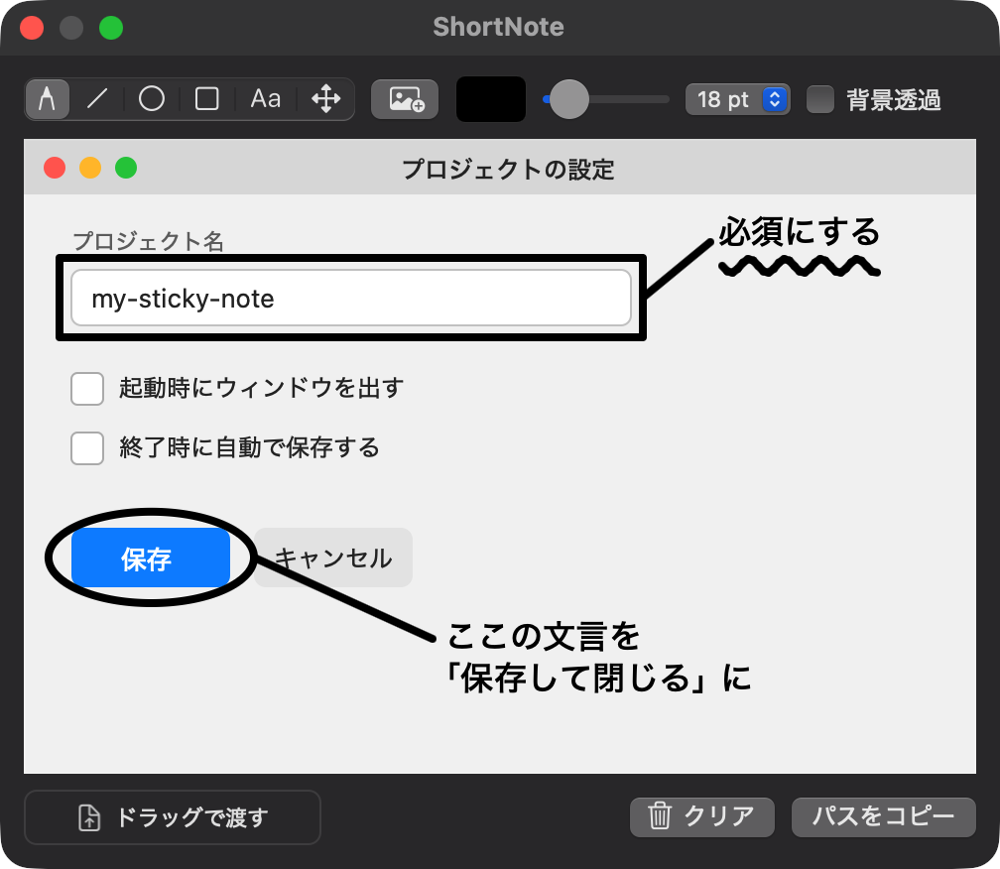

# ShortNote

付箋のように小さな、メニューバー常駐のペイントツール（macOS）。手書きでアイデアをさっとスケッチして、その画像の**ファイルパス**をコーディングエージェントに渡すためのもの。

ショートカット一発でウィンドウが出て、描いて、パスをコピーするかドラッグするだけ。設定なしで使えます（キーの割り当ては、後から変えられます）。

<p align="center">
  
</p>

上の画像は、設定画面を模した絵（コードで作ったもの）に、ShortNote で書き込んだ例です。

## 使い方

| 操作 | 方法 |
|---|---|
| ウィンドウを出す | 起動するとウィンドウが出ます。閉じても常駐し、`⌃⌥N`（またはメニューバーのアイコン）で再び出せます（キーは変更できます） |
| ウィンドウの大きさ | 端をドラッグして変えられます。緑のボタンで最大化できます（キャンバスは広がり、描いた内容は左上から動きません） |
| キャンバスのサイズ | メニューバーのアイコン →「キャンバスサイズ」で、プリセット（960×640、1280×720、1920×1080 など）か数値を選びます。書き出す PNG のピクセル数で、選んだサイズは次回の起動でも使われます |
| 描く | ペン／直線／円／四角（直線は、ボタンを押し続けると出るメニューで、線／矢印／両端の矢印を選べる。円・四角は、同じく、枠だけ／塗りつぶし）。マウス・トラックパッド・ペンタブレット（筆圧対応） |
| 文字を書く | 文字ツールでクリック → 入力。`Return` で確定、`Shift+Return` で改行、`Esc` で取り消し。大きさは、ツールバーの「文字サイズ」（12〜96 pt、既定 18 pt）で選びます（入力中に変えると、その場で変わります。ブラシの太さとは別です） |
| 画像を足す | `Cmd+V` で貼り付け、ツールバーの画像ボタン（または `Cmd+O`）でファイルを選ぶ、またはキャンバスへドラッグ＆ドロップ（ドロップ位置が中心） |
| 動かす・大きさを変える・回す | 移動ツールで、要素（ペン・直線・円・四角・画像・文字）をクリックすると、選ばれて取っ手が出ます。**回転の取っ手**（上の丸）をドラッグすると、要素の中心を軸に、時計回りに回ります（`Shift` で 15° きざみ）。**大きさの取っ手**：画像・円・四角・文字は四隅、直線は両端をドラッグします。画像と文字は縦横比を保ち（文字は文字サイズが変わります。常に等倍）、円・四角は保ちません（`Shift` を押している間は逆。画像・円・四角）。直線は、掴んだ端だけが動きます。フリーハンドは、回すだけで、大きさは変えられません。1 回のドラッグが、`Cmd+Z` の 1 段です |
| 範囲選択 | 移動ツールで、何もない所からドラッグすると、範囲が出て、**範囲にすっぽり入った要素が、まとめて選ばれます**。選んだ要素の、どれかを掴んでドラッグすると、まとめて動きます（1 回が `Cmd+Z` の 1 段）。大きな枠の中の部品を選ぶときは、`Shift` を押しながら、枠の上から始めます |
| 取り消し／やり直し | `Cmd+Z` / `Cmd+Shift+Z`（`Ctrl+Z` / `Ctrl+Shift+Z` も可） |
| 描いたものを消す | 下段の「クリア」、または `Cmd+K`。描いたもの（線・図形・文字・貼り付けた画像）をすべて消し、背景として開いた画像は残ります。`Cmd+Z` で戻せます |
| ツールを切り替える | `1` ペン、`2` 円、`3` 四角、`4` 文字、`5` 移動、`6` 直線。ブラシの太さは `[` で細く、`]` で太く |
| 閉じる | `Esc` |
| ショートカットを変える | メニューバーのアイコン →「ショートカット…」。「変更…」を押して、割り当てたいキーを押します。他のコマンドと重なるキーは割り当てられません（理由が表示されます）。「なし」で外し、「初期値」「すべて初期値に戻す」で戻せます。変更は次回の起動でも使われます |
| パスを渡す | 「パスをコピー」（または `Cmd+Shift+C`）、または「ドラッグで渡す」をエージェントの入力欄へドラッグ |

- 書き出し先は `/tmp/shortnote/note-<日時>.png`（PNG）。「背景透過」をオンにすると透明背景で書き出します。
- 画像を開いて始めたいときは、ファイルとして渡します。起動済みでも、常駐中のウィンドウに読み込まれます。

  ```sh
  open -a ShortNote /path/to/image.png
  ```

  `open -a ShortNote --args /path/to/image.png` は、**起動していないときにだけ**効きます。ターミナルから実行ファイルを直接実行する場合（`ShortNote /path/to/image.png`）は、起動済みでも渡されます。

## エージェントから使う（CLI）

コーディングエージェントが、シェルから、画像に図形・文字を書き込めます（アプリを起動せずに、PNG を作ります）。操作は JSON で渡します（仕様は [SPEC.md §3.7](SPEC.md)）。

```sh
# 背景の画像に、楕円と文字を重ねて、PNG にする（座標はキャンバスのポイント。左上が原点）
echo '{"version":1,"ops":[
  {"op":"ellipse","x":12,"y":188,"w":104,"h":46,"color":"#ff0000"},
  {"op":"text","x":212,"y":240,"text":"ここを直す","color":"#ff0000"}
]}' | /Applications/ShortNote.app/Contents/MacOS/ShortNote render screenshot.png - -o out.png
```

操作は `pen`・`line`・`ellipse`・`rect`・`text`・`image`（`line` は、`"arrow": "end"`（終点に矢じり）・`"both"`（両端）で矢印にできます。`ellipse`・`rect` は、`"fill": true` で塗りつぶせます。`ellipse`・`rect`・`text`・`image` は、`"rotate": 度` で、枠の中心を軸に、時計回りに回せます）。範囲外の座標は、キャンバスの縁に丸められます。成功すると、標準出力に 1 行の JSON（出力のパス、ピクセル数、丸めた・足さなかった操作の番号）が出ます。失敗は、標準エラーの JSON と、終了コード（1 操作の JSON が不正、2 引数の誤り、4 ファイルの入出力）です。

### 常駐中のアプリのキャンバスに書き込む

メニューバーに常駐している ShortNote のキャンバスに、直接、足すこともできます（人が見ているキャンバスに出て、Cmd+Z でまとめて取り消せます。人が文字を入力している間や、ドラッグしている間も使え、その入力・ドラッグは壊れません）。

```sh
ShortNote=/Applications/ShortNote.app/Contents/MacOS/ShortNote
$ShortNote draw ops.json     # 操作を足す（アプリが動いていなければ、フォーカスを奪わずに起動する）。`-` で標準入力
$ShortNote get               # キャンバスの大きさ・背景・確定済みの要素（操作の JSON と同じ形）・editing
$ShortNote export            # 確定済みの内容を PNG に書き出して、パスを返す
$ShortNote clear             # 描いたものを消す（背景は残る。取り消せる）
```

終了コードは、0 成功、1 操作の JSON が不正（何も適用しない）、2 引数の誤り、3 アプリに届かない（`get`・`export`・`clear` は、動いていなければ起動しない）、4 ファイルの入出力です。アプリとの通信は、同じユーザーだけが使える Unix ドメインソケット（`~/Library/Application Support/ShortNote/`）だけで、ネットワークには出ません。

### コマンド「snote」

フルパスの代わりに、`snote` と打てるようにできます。メニューバーのアイコン →「コマンド「snote」を入れる…」を押すと、`/usr/local/bin/snote` に、アプリの実行ファイルへのリンクを張ります（管理者のパスワードを求められます）。リンク先は、アプリのパスなので、アプリを更新しても、そのまま使えます。外すのも、同じ項目です（自分のリンクだけを消します）。同じ名前の別のものがあるときは、上書きしません。

```sh
snote render screenshot.png ops.json -o out.png
snote draw ops.json
snote --help                 # 使い方（`snote help draw` や `snote draw --help` で、コマンドごとの説明）
snote --version              # ShortNote 0.2.0 のように、版
```

自分で張るなら、次のとおりです（アプリを「アプリケーション」に置いてから）。

```sh
sudo mkdir -p /usr/local/bin
sudo ln -s /Applications/ShortNote.app/Contents/MacOS/ShortNote /usr/local/bin/snote
```

### エージェント向けの skill

エージェントに、この CLI の使い方を伝える skill を、[skills/shortnote/SKILL.md](skills/shortnote/SKILL.md) に置いています（コマンド、操作の JSON、座標と画像との対応、終了コード、矢印の作り方、注意点）。お使いのエージェントの skill の置き場（Claude Code なら `~/.claude/skills/`）へ、`skills/shortnote` ディレクトリをコピーして使います。

## ダウンロード

リリースは、タグ `vX.Y.Z` のときに GitHub Actions が作ります。公開されたリリースは [Releases](https://github.com/takemo101/shortnote/releases) に並び、`ShortNote-X.Y.Z.dmg` をダウンロードできます（macOS 13 以降、Apple Silicon と Intel の両対応）。DMG を開いて、ShortNote を「Applications」へドラッグしてください。

署名が ad-hoc（Developer ID の署名・公証なし）のため、初回は macOS の Gatekeeper に止められます。右クリック →「開く」、または `xattr -dr com.apple.quarantine /Applications/ShortNote.app` で開けます。

## ビルド

macOS 13 以降、Swift 5.9 以降（Xcode または Command Line Tools）が必要です。

```sh
just build    # build/ShortNote.app（arm64 + x86_64 の Universal）
just run      # ビルドして起動（メニューバーに常駐）
just try      # ビルドして前面で起動（ログが端末に出る）。画像を渡すなら: just try path/to/image.png
just package  # build/ShortNote.dmg
```

`just` が無い場合は、`./scripts/build.sh` と `./scripts/dmg.sh` を直接実行できます。レシピの一覧は `just` で表示します。

単体テストは `./scripts/test.sh`（`just test`）、実機の操作を含む検証は `just e2e` です。

`dmg.sh` は既定で ad-hoc 署名です。他の Mac では Gatekeeper に止められるので、右クリック →「開く」、または次のコマンドで検疫属性を外します。

```sh
xattr -dr com.apple.quarantine /Applications/ShortNote.app
```

Developer ID で署名・公証する場合は、スクリプト冒頭のコメントを参照してください。

## 仕様・開発

- [SPEC.md](SPEC.md)：仕様と受け入れ条件（唯一の正本）
- [AGENTS.md](AGENTS.md)：開発規約（mikan・GitButler・検証の運用）
- [docs/](docs/README.md)：開発手順・構成説明・検証手順と記録

## ライセンス

[MIT](LICENSE)
