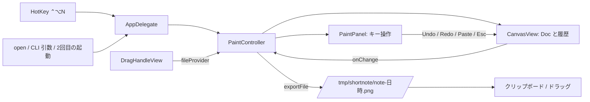

# 構成説明

ShortNote の Module の責務・状態の所有・座標と倍率・失敗の関係を説明する。要件は [SPEC.md](../SPEC.md) が正本であり、本書は選択済みの構成とその理由を述べる。API の保証や、動作の成功証拠ではない（証拠は [検証記録](verification.md)）。

## Module と責務

`Sources/ShortNote/` の 6 ファイル。外部パッケージはなく、AppKit・Carbon・UniformTypeIdentifiers だけを使う。

| Module | 責務 | 持つ状態 |
|---|---|---|
| `main.swift` | `NSApplication` を accessory（Dock に出ない）で起動する | なし |
| `AppDelegate` | メニューバーの項目、全域ショートカット ⌃⌥N の登録、多重起動の転送、`open` や CLI 引数での画像受け取り | `statusItem`、`hotKey`、遅延生成の `PaintController` |
| `HotKey` | Carbon の `RegisterEventHotKey`（アクセシビリティ権限が要らない）で単一の全域ショートカットを登録する | 登録参照、ハンドラ（static） |
| `PaintController` と `PaintPanel` | ウィンドウ（非アクティブ型の浮動パネル）と操作部品、キー操作の受付、書き出しの再利用 | 部品、`cachedURL`、位置決め済みか |
| `CanvasView` | 描画内容と履歴、ポインタ入力、文字入力、画像の貼り付け／ドロップ、描画と PNG 書き出し | `Doc`、取り消し／やり直しの履歴、描画中の要素、移動・入力中の一時状態、ツール・色・太さ・透過 |
| `DragHandleView` | 「ドラッグで渡す」。ドラッグ開始時に最新の PNG を書き出し、パスを渡す | なし |

### 状態の所有

- 描画内容は `CanvasView` だけが持つ。`Doc`（背景画像と要素の配列）の値コピーを履歴に積むので、取り消し／やり直しは「直前の `Doc` へ戻す」操作になる。画像の読み込み・貼り付け・ドロップ・文字・移動も同じ履歴に入る。
- 要素（`Item`）は種別（ペン・円・四角・文字・画像）ごとに、線の太さ／文字の大きさ、色、座標、文字、画像を持つ。位置の移動は要素の値を平行移動した複製へ置き換える。
- 書き出しの再利用は `PaintController` が持つ。`CanvasView.onChange`（書き出し結果が変わる操作）で `cachedURL` を捨てる。
- 履歴は上限を持たない。プロセスの寿命の間、積み続ける。画像を多く扱うと、そのぶんメモリを使う。

### 時間と並行

すべてメイン実行ループで動き、独自のスレッド・タイマー・監視を持たない。描画していない間は何もしない。唯一の遅延は、コピーボタンの表示を 1.2 秒後に戻す一回限りの `asyncAfter`。

## 入力の経路

- **ポインタ**：`CanvasView.mouseDown/Dragged/Up`。ツールによって、ペン（点列）、図形（ドラッグ範囲）、文字（編集開始）、移動（クリック位置の最前面の要素）に振り分ける。筆圧は、タブレットのイベント（`.tabletPoint`）のときだけ使う。
- **キー**：メニューバーを持たないアプリなので、標準の「編集」メニューのショートカットは効かない。`PaintPanel.sendEvent` が、Esc・Cmd/Ctrl+Z・Cmd+V を直接処理する。文字入力中は、Esc を入力の取り消し、Cmd+C/X/V/A/Z を文字欄へ転送する（これが無いと文字欄でコピー・貼り付けができない）。
- **文字入力**：キャンバス上に `NSTextView` を重ね、確定時に `Item` へ変換して取り除く。Return で確定、Shift／Option+Return で改行。パネルがキーを失ったとき、ツールを変えたとき、別の場所をクリックしたとき、書き出し・取り消し・やり直しの前にも確定する。
- **画像**：クリップボードとドロップは同じ読み取り（`CanvasView.images(from:)`）を通す。ファイル URL があれば画像のものだけを採り、無ければ画像データを採る。ファイル URL があるのに画像でない場合は、ファイルのアイコン画像を拾わないよう、何も採らない。
- **多重起動**：2 回目の起動は、同じ bundle ID の実行中インスタンスがあれば、`DistributedNotificationCenter` で画像パスを渡して自分は終了する。

### ウィンドウ

`PaintPanel` は `.nonactivatingPanel` かつ `.floating` で、フォーカスを持ったまま他アプリを前面に残せる。コーディングエージェントの入力欄などを使っているアプリを、ウィンドウを出したことで奪わないための選択。`canBecomeKey` を真にして、キー入力と文字入力を受ける。位置は最初の一回だけ画面中央に置き、以後は動かさない。

## 座標と倍率

- **ビュー座標**：`CanvasView` は反転しないビューで、原点は左下。要素の座標はすべてこの座標（ポイント）。キャンバスは 480×320 pt。
- **画面座標**：Accessibility・CGEvent・CGWindow は左上原点。検証（`scripts/native-e2e.swift`）はこの違いを、ウィンドウの bounds とキャンバスの位置から換算している。
- **書き出し**：画面表示と書き出しは、同じ `drawContent` を通す。書き出しはビットマップコンテキストで、ピクセル座標になるため、描画前に（ピクセル数÷ポイント数）の倍率を掛ける。倍率は 2 を下限とし、背景・画像の元解像度に合わせて最大 4 まで上げる。背景画像は、キャンバスに収まるよう縮小して中央に置く（拡大しない）。

## 失敗の扱い

| 状況 | 振る舞い |
|---|---|
| 画像を開けない（CLI・`open`） | 何も変えない（`loadImage` が `false`） |
| 貼り付け・ドロップに画像が無い | ビープ音。キャンバスは変えない |
| PNG の生成に失敗 | `exportFile` が `nil`。パスをコピーしない。ドラッグも始めない |
| PNG の書込みに失敗 | ビープ音。`nil` を返し、パスをコピーしない |
| 全域ショートカットを登録できない | アプリは動く。メニューに「登録できませんでした」と表示する |
| 大きさのない図形 | 捨てる |
| 空の文字 | 確定しても追加しない |

## 既知の制約

- 書き出し先は `/tmp/shortnote/` に固定で、削除しない。OS の再起動などで消えるまで、書き出したファイルが残る。
- 履歴に上限がない。
- 貼り付け・ドロップした画像の大きさを変えられない。確定済みの文字は再編集できない。
- 全域ショートカットは ⌃⌥N に固定で、変更できない。
