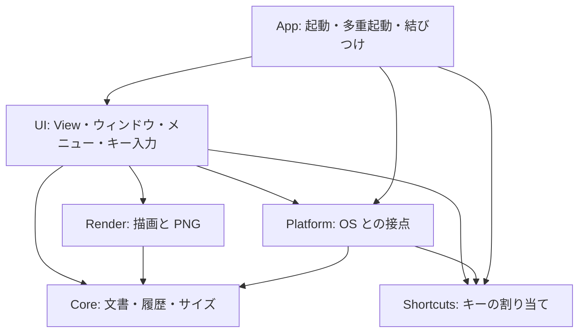

# 構成説明

ShortNote の Module の責務・状態の所有・座標と倍率・失敗の関係を説明する。要件は [SPEC.md](../SPEC.md) が正本であり、本書は選択済みの構成とその理由を述べる。API の保証や、動作の成功証拠ではない（証拠は [検証記録](verification.md)）。設計原則の出典と選択は [参考にした設計原則](references.md)。

## Module と責務

外部パッケージはなく、AppKit・Carbon・UniformTypeIdentifiers だけを使う。コードは SwiftPM の 3 つのターゲットに分かれる。

| ターゲット | 場所 | 役割 |
|---|---|---|
| `ShortNote`（実行ファイル） | `Sources/ShortNote/main.swift` | `ShortNoteKit.runShortNote()` を呼ぶだけ |
| `ShortNoteKit`（ライブラリ） | `Sources/ShortNoteKit/` | アプリ本体。単体テストから `@testable import` で使う |
| `ShortNoteKitTests` | `Tests/ShortNoteKitTests/` | Swift Testing の単体テスト（`scripts/test.sh`） |

`ShortNoteKit` は、変わる理由ごとに 6 つのディレクトリへ分ける。**依存は上から下へだけ**向く（Core と Shortcuts は AppKit を `import` しない）。

| ディレクトリ | ファイル | 責務 | 持つ状態 |
|---|---|---|---|
| `Core/` | `Item` | キャンバスの要素。種類ごとに必要な値だけを持つ（`enum Content`）。範囲（`bounds`）と平行移動 | なし（値型） |
| | `Document` | 背景画像と要素の配列。追加・移動・当たり判定を、新しい値を返す形で行う | 値型 |
| | `History<State>` | 取り消し・やり直し。積む・戻す・やり直す、200 段の上限、新しい操作でやり直しを捨てる規則 | 2 つのスタック |
| | `CanvasSize`、`CanvasSizeStore` | キャンバスのサイズ（書き出しのピクセル数）。`parse` が検証して `Result` を返す。存在する値は常に有効。保存（`UserDefaults`） | なし |
| `Shortcuts/` | `Command` | キーで呼べる操作の一覧（タイトル・グループ・全域か） | なし |
| | `KeyChord` | 物理キーコード＋修飾キー。同一性はキーコードと修飾キーだけ（ラベルは表示用）。文字入力中に使えるか、全域にできるかの判定 | なし |
| | `KeyBindings` | コマンドとキーの対応。**既定との差分だけ**を持つ。割り当て・解除・初期値は `Result`／新しい値で返す。重なり・予約済み・全域の修飾キーを検証 | 差分（値型） |
| | `KeyBindingsStore` | 差分の保存（`UserDefaults` の `keyBindings`）。読み込み時に、無効・重なる項目を落として理由を返す | なし |
| | `KeyRouter` | 押されたキーを、実行・文字入力欄へ転送・入力の取り消し・素通しのどれにするか決める純粋な関数。文字入力中の素の Esc は、割り当てに依らず取り消し | なし |
| `Render/` | `CanvasRenderer` | 画面と書き出しで共通の描画（`drawContent`）、市松模様の下地、PNG の生成 | なし |
| `Platform/` | `ImageIntake` | 画像を `ImportedImage` にする入口（ペーストボード・ドロップ・ファイル選択・CLI）。`Result` で返す。ビットマップは画素をそのまま、PDF などは書き出し倍率の画素に描く。CLI・`open` で明示された 1 つのファイルだけは、種類で絞らず読む | なし |
| | `ExportStore` | 書き出し先 `/tmp/shortnote/`、直前のファイルの再利用、`ExportError`（生成失敗・書込み失敗） | `cachedURL` |
| | `GlobalHotKey` | Carbon の `RegisterEventHotKey`（アクセシビリティ権限が要らない）で全域ショートカットを登録。登録し直せる | 登録参照、ハンドラ（static） |
| | `KeyboardLayout` | 現在のキーボード配列（US・JIS など）で、物理キーが出す文字を調べる（`UCKeyTranslate`）。`[` `]` の既定のキーを決めるのに使う | なし |
| `UI/` | `CanvasView` | ポインタ入力を `Document` の変更につなぐ。履歴を持ち、描画は `CanvasRenderer` に任せる | `Document`、`History`、描画中の要素、移動中の一時状態、ツール・色・太さ・透過 |
| | `InlineTextEditor` | キャンバス上の文字入力欄。確定した文字を `Entry` で返す | 入力中の `NSTextView` |
| | `PaintPanel` | キー入力を先に受けて `keyHandler` に渡す（メニューバーを持たないアプリのため） | なし |
| | `PaintWindowController` | パネルの組み立て、`perform(Command)`（ツールバーもキーも同じ経路）、画像の選択、パスのコピー、書き出し | `ExportStore`、位置決め済みか |
| | `Toolbar` | 上段・下段の部品。操作はコールバックで通知し、ツールチップに現在のキーを出す | 部品 |
| | `CanvasSizing` | ウィンドウとキャンバスの大きさの対応、数値入力・エラーのダイアログ | なし |
| | `ShortcutCenter` | `KeyBindings` と `Store` の窓口。変更を保存し、通知する | `bindings`、記録中か、全域キーを登録できているか |
| | `ShortcutsWindowController` | ショートカットの設定ウィンドウとキーの記録 | 記録中のコマンド、ローカルのキー監視 |
| | `StatusMenu` | メニューバーの項目 | `statusItem` |
| | `KeyChord+Event`、`DragHandleView` | `NSEvent` から `KeyChord` への変換（境界で一度だけ）、「ドラッグで渡す」 | なし |
| `App/` | `AppDelegate`、`Launch` | 起動、`ShortcutCenter` の変更に応じた全域キーの登録し直し、多重起動の転送、`open`／CLI 引数での画像受け取り | `statusMenu`、`hotKey`、遅延生成のコントローラ |

### 設計原則との対応

[references.md](references.md) で選んだ原則が、コードのどこに現れているか。

| 原則 | 現れている場所 |
|---|---|
| 変わる理由で分ける（package-design） | 上のディレクトリ分割。描画の見た目は `Render`、OS の事情は `Platform`、規則は `Core`／`Shortcuts` |
| 境界で一度だけ型にする（parse-dont-validate） | `CanvasSize.parse`、`KeyChord(event:)`、`KeyBindingsStore.load`、`ImageIntake`。内側は再検証しない |
| 常に有効な値（domain-primitives） | `CanvasSize`（偶数・最小・上限）、`Item.Content`（種類ごとの値）、`History`（上限は 1 以上） |
| 集合の規則を 1 か所に（first-class-collection） | `Document`（要素の追加・移動・当たり判定）、`KeyBindings`（割り当ての一意性） |
| 教えて頼む（tell-dont-ask） | `History.undo(current:)` が次の状態を返す。`Document.translatingItem` が検証して返す |
| 失敗を値で返す（error-handling） | `Result` と小さな `enum`（`CanvasSize.Error`、`AssignError`、`ExportError`、`ImageIntakeError`）。警告や beep を決めるのは UI だけ |
| 目的が同じなら 1 つに（intent-based-dedup） | 画面と書き出しの描画、貼り付け・ドロップ・選択・CLI の画像取り込み、ツールバーとキーのコマンド実行 |
| 保存形式の互換（backward-compat-governance） | `KeyModifiers` のビット値と `Command.rawValue` は保存されるので変えない。`keyBindings` は差分だけを保存し、未知のコマンド・無効なキーは読み込みで落とす |

### 状態の所有

- 描画内容は `CanvasView` だけが持つ。`Document` の値コピーを `History` に積むので、取り消し／やり直しは「直前の `Document` へ戻す」操作になる。画像の読み込み・貼り付け・ドロップ・文字・移動も同じ履歴に入る。
- 位置の移動は、移動前の `Document`（`base`）から平行移動した複製を作り直して置き換える。ドラッグが終わって初めて履歴に積む（途中の位置は履歴に残さない）。
- 書き出しの再利用は `ExportStore` が持つ。`CanvasView.onChange`（書き出し結果が変わる操作）で `invalidate()` する。
- キャンバスのサイズ（標準 960×640 px、プリセット、数値）は `CanvasSizeStore` が `UserDefaults`（`canvasWidthPx`・`canvasHeightPx`）に保存する。サイズは、書き出すピクセル数を 2 で割ったポイント数として、ウィンドウを作る時点（`PaintWindowController.init`）で適用する（画像つきで起動したときも、背景の配置が、そのキャンバスの大きさで決まる）。保存値は `CanvasSize.fitting` で今の画面に収まるよう縮めてから適用する（保存値は変えない）。適用は、ウィンドウの左上を動かさずに、キャンバスがちょうどその大きさになるよう、枠の分を足して大きさを決める。メニューは `StatusMenu` が組み、開くたびに `menuNeedsUpdate` で保存中のサイズにチェックを付ける。
- ショートカットの割り当ては `ShortcutCenter` が持つ。変更のたびに `KeyBindingsStore` が保存し、`AppDelegate`（全域キーの登録し直し、メニューの表示）、`PaintWindowController`（ツールチップ）、設定ウィンドウ（一覧）へ `onChange` で知らせる。キーを記録している間は `isRecording` が真で、全域ホットキーは外す（記録するキーが先に奪われないように）。
- 履歴は 200 段で打ち切る。プロセスの寿命の間、積む。画像を多く扱うと、そのぶんメモリを使う。

### 時間と並行

すべてメイン実行ループで動き、独自のスレッド・タイマー・監視を持たない。描画していない間は何もしない。遅延は、コピーボタンの表示を 1.2 秒後に戻す一回限りの `asyncAfter` と、キーを記録している間だけ置くローカルのキー監視（記録が終わる・ウィンドウが閉じると外す）。

## 入力の経路

- **ポインタ**：`CanvasView.mouseDown/Dragged/Up`。ツールによって、ペン（点列）、図形（ドラッグ範囲）、文字（編集開始）、移動（クリック位置が外接する範囲に入る最前面の要素）に振り分ける。ボタンを押したままの間に取り消し・やり直し・貼り付けなどで履歴が動いたときは、描きかけの線を捨て、移動中の要素は移動前へ戻す（古い状態を書き戻さない）。筆圧は、タブレットのイベント（`.tabletPoint`）のときだけ使う。
- **キー**：メニューバーを持たないアプリなので、標準の「編集」メニューのショートカットは効かない。`PaintPanel.sendEvent` がキー押下を `PaintWindowController.handleKey` へ渡し、`KeyChord(event:)` で型にして `KeyRouter.route` が決める。
  - 日本語入力の変換中は、すべてのキーを入力システムへ渡す（Esc は変換だけを取り消し、入力中の文字は消さない）。
  - 文字入力中は、素の Esc を入力の取り消しにする（Esc の割り当てがどう変わっていても）。Cmd+C/X/A は文字欄へ転送し、残りは「文字入力と衝突しないキー」（Cmd／Ctrl 付き、素の F キー）のコマンドだけを実行する。素の文字キー（既定のツール 1〜5、ブラシ `[` `]`）は入力になる。
  - 実行は `PaintWindowController.perform(Command)`。文字入力中は、取り消し・やり直し・貼り付けを文字欄の操作へ転送し、「ウィンドウを隠す」に割り当てた別のキーは入力の取り消しに使い、画像ファイルの選択のキーは無視する。ツールバーのボタンも同じ `perform` を呼ぶ（画像を追加のボタンだけは、入力を確定してから開くので、入力中でも効く）。
  - キーは物理のキーコードで判断する（割り当ては配列を切り替えても位置が動かない）。物理キーの位置が配列で違う `[` `]` だけは、起動時に、いまの配列でその文字を出すキーを探して既定にする（`KeyboardLayout`、`KeyBindings.standardDefaults`）。見つからないときは US 配列の位置。保存するのは、既定との差分だけなので、配列由来の既定は保存しない。
- **ショートカットの設定**：メニューの「ショートカット…」が `ShortcutsWindowController` を開く。「変更…」でローカルのキー監視を置き、次に押したキーを `ShortcutCenter.assign` に渡す。拒否（他のコマンドと重なる・予約済み・全域に ⌃⌥⌘／F キーがない）は理由を表示して何も変えない。「初期値」も、初期値のキーを他のコマンドが使っていれば拒否する。Esc は記録の取り消しに使う。別のウィンドウへ移ったときも記録を取り消す（記録中は全域ホットキーを外しているため）。
- **文字入力**：`InlineTextEditor` がキャンバス上に `NSTextView` を重ね、確定時に `Entry` を返して、`CanvasView` が `Item` に変換する。Return で確定、Shift／Option+Return で改行。パネルがキーを失ったとき、ツールを変えたとき、別の場所をクリックしたとき、書き出し・取り消し・やり直しの前にも確定する。
- **画像**：クリップボード・ドロップ・ファイル選択は `ImageIntake` で `ImportedImage` にし、同じ配置（`place`）を通す。ファイル選択は `PaintWindowController.pickImages`（`NSOpenPanel` を、パネルへのシートとして開く。キーとツールバーのボタンの両方から）。読み取りは、ファイル URL があれば画像のものだけを採り、無ければ画像データを採る。ファイル URL があるのに画像でない場合は、ファイルのアイコン画像を拾わないよう、何も採らない。
- **起動**：起動時に、ウィンドウを出す（画像を渡されていれば、背景として読み込んでから）。ウィンドウを閉じてもアプリは常駐する。
- **多重起動**：2 回目の起動は、同じ bundle ID の実行中インスタンスがあれば、`DistributedNotificationCenter` で画像パスを渡して自分は終了する。通知名は bundle ID から決める（本番は `dev.takemo101.shortnote.open`）ので、bundle ID を変えたコピー（検証用）は、実行中の本番インスタンスと互いに影響しない。

### ウィンドウ

`PaintPanel` は `.nonactivatingPanel` かつ `.floating` で、フォーカスを持ったまま他アプリを前面に残せる。コーディングエージェントの入力欄などを使っているアプリを、ウィンドウを出したことで奪わないための選択。`canBecomeKey` を真にして、キー入力と文字入力を受ける。位置は最初の一回だけ画面中央に置き、以後は動かさない。

大きさは変えられ、最大化ボタン（ズーム）が使える。ユーティリティ型の窓は最大化ボタンを持たないので、通常のタイトルバー（閉じる・最大化）の窓にしている。最小化は持たない（最小化すると、Dock にしか戻る入口がなく、常駐アプリの形に合わない）。内容の配置は、明示的な制約で組む：上段（ツール）と下段（ドラッグで渡す・コピー）は固定の高さで、キャンバスだけが伸び縮みし、キャンバスの最小の大きさがウィンドウの最小になる。`CanvasView` は大きさが変わると `onChange` を呼び、書き出しの再利用を無効にする（寸法が変わるため）。

ショートカットの設定ウィンドウは、別の通常のウィンドウ（`NSWindow`、閉じるだけ）。パネルとは独立で、キー入力はパネルの `sendEvent` を通らない。

## 座標と倍率

- **ビュー座標**：`CanvasView` は反転したビュー（`isFlipped`）で、原点は左上。要素の座標はすべてこの座標（ポイント）。ウィンドウを広げても、描いた内容は左上から動かない。キャンバスの大きさは、最小 480×320 pt からウィンドウに合わせて変わる。
- **画面座標**：Accessibility・CGEvent・CGWindow は左上原点。検証（`scripts/native-e2e.swift`）はこの違いを、ウィンドウの bounds とキャンバスの位置から換算している。
- **書き出し**：画面表示と書き出しは、同じ `CanvasRenderer.drawContent` を通す。書き出しは、現在のキャンバス全体をビットマップコンテキストへ描く。ビットマップはピクセル座標で左下原点なので、上下を反転して（ピクセル数÷ポイント数）の倍率を掛け、反転済みのコンテキストとして渡す。倍率は **2 に固定**する（`CanvasSize.exportScale`）ので、書き出しのピクセル数は、キャンバスのポイント数の 2 倍になる。長辺が 8192 ピクセルを超える巨大なキャンバスでだけ、倍率を下げる。画像は、左上原点のコンテキストの上で、その場で上下を反転して描く（描き方を 1 か所に集めたので、画面と書き出しで向きが揃う）。
- **背景画像**：開いた時点のキャンバスに収まるよう縮小して中央に置き（拡大しない）、その位置（`Document.backgroundRect`）を保持する。ウィンドウの大きさを変えても、描いた内容とずれないよう動かさない。

## 失敗の扱い

失敗は、`Result` と小さな `enum` で返す。警告・ビープ・ダイアログを決めるのは UI（`PaintWindowController`、`CanvasSizeDialog`、`ShortcutsWindowController`）だけ。

| 状況 | 振る舞い |
|---|---|
| 画像を開けない（CLI・`open`） | 何も変えない（`loadImage` が `false`） |
| 貼り付け・ドロップ・ファイル選択に画像が無い（`ImageIntakeError.noImage`） | ビープ音。キャンバスは変えない |
| PNG の生成に失敗（`ExportError.renderFailed`） | ビープ音。パスをコピーしない。ドラッグも始めない |
| PNG の書込みに失敗（`ExportError.writeFailed`） | ビープ音。パスをコピーしない |
| キャンバスのサイズが不正（`CanvasSize.Error`） | 理由を示すダイアログ。何も変えない・保存しない |
| ショートカットの割り当てが不正（`AssignError`。「初期値」で戻すときの重なりを含む） | 設定ウィンドウに理由を表示。何も変えない |
| 保存した割り当てが読めない・一部が無効 | 読めないときは全体を初期値に、一部の無効（重なり・予約済み）は、その割り当てだけを無視して、設定ウィンドウに表示する |
| 全域ショートカットを登録できない | アプリは動く。メニューに「登録できませんでした」と表示し、設定ウィンドウも、開いたときと、割り当てを変えるたびに知らせる |
| 大きさのない図形 | 捨てる |
| 空の文字 | 確定しても追加しない |

## 既知の制約

- 書き出し先は `/tmp/shortnote/` に固定で、削除しない。OS の再起動などで消えるまで、書き出したファイルが残る。
- 取り消せるのは 200 段まで。超えると古い順に捨てる（長い作業でメモリが増え続けないように）。
- 貼り付け・ドロップ・ファイル選択した画像の大きさを変えられない。確定済みの文字は再編集できない。
- キャンバスのズームとスクロールがない。ウィンドウを縮めるとはみ出した内容は見えなくなり（広げれば戻る）、書き出しには含まれない。
- 全域ショートカットは、他のアプリが同じキーを使っていると登録できない（`RegisterEventHotKey` の制約）。登録に失敗しても割り当ては保存される。
- 設定ウィンドウでは、Esc を割り当てられない（Esc は記録の取り消しに使う）。Esc に戻すときは「初期値」を使う。
- キャンバスのサイズの保存は `UserDefaults` の 2 項目だけ。最小未満・長辺 8192 超・奇数・画面に収まらないサイズは設定できず、保存もしない。保存したサイズが、いまの画面に収まらないときは、収まる最大まで縮めて起動する（保存した値は変えない）。
